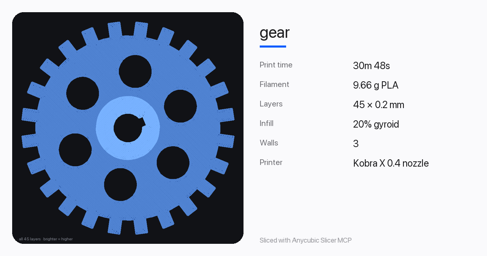

<p align="center">
  <a href="https://pri-te-sh.github.io/anycubic-slicer-mcp/"></a>
</p>

<p align="center">
  <a href="https://github.com/pri-te-sh/anycubic-slicer-mcp/actions/workflows/tests.yml"></a>
  
  
  <a href="https://modelcontextprotocol.io"></a>
  <a href="LICENSE"></a>
  <a href="CONTRIBUTING.md"></a>
</p>

<p align="center">
  <a href="https://pri-te-sh.github.io/anycubic-slicer-mcp/"><b>Website</b></a> ·
  <a href="#install">Install</a> ·
  <a href="#tools">Tools</a> ·
  <a href="#faq">FAQ</a> ·
  <a href="CONTRIBUTING.md">Contribute</a>
</p>

# Anycubic Slicer MCP

**Anycubic Slicer MCP** is an open-source [Model Context Protocol](https://modelcontextprotocol.io) server for **Anycubic Slicer Next** on Windows and macOS. It lets Claude, Cursor, Codex, Antigravity or any other MCP client slice STL, 3MF, OBJ and STEP files, preview the G-code and plan a print before you commit filament to it.

You can ask for things like:

- "Slice gear.stl for my Kobra X with 20% gyroid and three walls, and show me layer 12."
- "Here's a photo of my new spool. Make a filament profile from the label."
- "This print came out stringy and the corners lifted. What should I change?"
- "This bracket gets bent from the side. Make it stronger and tell me what that costs in time."
- "How much filament does this two-colour print waste on colour changes?"

The server drives the slicer's own command line on your computer. It never sends anything to a printer, so you still check the preview and press print yourself.

## What it does

### Slice from a sentence

`slice_model` takes preset names (or the selection in the slicer window) and any setting override by name: infill, walls, supports, brim, layer height, temperatures. It handles rotation, scale, copies and multi-colour plates, and writes both a `.gcode` file and a printer-ready `.gcode.3mf`.

A real run on the example gear, with a Kobra X and 0.4 mm nozzle: **30m 48s, 9.66 g of PLA, 45 layers at 0.2 mm.**

### See the toolpaths before printing

| One layer, coloured by feature | Every layer, shaded by height | Shareable print card |
|---|---|---|
|  |  |  |

`preview_gcode` also draws a side view for checking overhangs and supports. `animate_layers` saves a GIF of the print building up.

### Filament profile from a photo of the label

Your agent reads the spool label (brand, material, colour, temperature ranges, weight) and `create_filament_profile` turns it into a preset that inherits from the closest one your printer already has. It shows a preview first and saves only when you confirm. Spools can go into a small local inventory, so the agent can tell you which one has enough left for the next print.

### Print doctor

Send photos of a failed print. The agent matches what it sees to one of 13 defects (stringing, warping, layer adhesion, first layer, under and over extrusion, elephant foot, ringing, overhangs, bridging, top surface, layer shift and seams). `diagnose_print` then suggests setting changes based on the presets you used. When two fixes would push the same setting in opposite directions, it reports the conflict and leaves that setting alone.

### Stronger parts

Tell it how the part is loaded (tension, compression, bending, impact or torsion) and in which direction. `analyze_strength` looks for thin waists in the shape and recommends an orientation and settings. `find_best_orientation` ranks ways to lay the model on the bed for least support, speed, strength, bed adhesion or a balance of them.

### Multi-colour waste

On a single-nozzle printer every colour change flushes filament. In a two-colour test on a Kobra X, 12.37 g of a 25.07 g print went to colour changes. `optimize_multicolor` measures that waste for your model, tests settings that might reduce it, and recommends one only if every colour is kept and it saves filament. It also suggests layout changes.

### Calibration prints

`make_calibration_print` generates and slices a temperature tower (it changes the nozzle temperature at each block for you), flow-ratio cubes, retraction towers, or five first-layer squares spread across the bed.

### Planning and cost

`compare_slices` runs up to eight variants side by side. `estimate_cost` adds electricity and any labour or markup. `check_bed_fit` says whether a model fits and suggests a 45° turn, scaling, laying it down or splitting it if it doesn't.

## Install

You need:

1. Anycubic Slicer Next, installed from Anycubic's website and opened once, with your printer selected.
2. [uv](https://docs.astral.sh/uv/getting-started/installation/).

Then install the server:

```bash
uv tool install --python 3.13 git+https://github.com/pri-te-sh/anycubic-slicer-mcp
```

That puts an `anycubic-slicer-mcp` command on your PATH (`uv tool dir --bin` prints where).

### Let your agent set it up

Copy this into Claude Code, Cursor, Codex, Antigravity or another coding agent. The same prompt is behind the **Copy prompt for your agent** button on the [website](https://pri-te-sh.github.io/anycubic-slicer-mcp/).

```text
Set up the Anycubic Slicer MCP server (https://github.com/pri-te-sh/anycubic-slicer-mcp) on this computer and connect it to the AI app you are running in.

1. Check that Anycubic Slicer Next is installed. On macOS look for /Applications/AnycubicSlicerNext.app; on Windows look for C:\Program Files\AnycubicSlicerNext\AnycubicSlicerNext.exe. If it is missing, stop and ask me to install it from Anycubic's website and open it once.
2. Check that uv is installed (run: uv --version). If it is not, show me the official install command from https://docs.astral.sh/uv/getting-started/installation/ and wait for me to run it.
3. Install the server:
   uv tool install --python 3.13 git+https://github.com/pri-te-sh/anycubic-slicer-mcp
4. Find the full path of the anycubic-slicer-mcp command (run: uv tool dir --bin).
5. Register it as a stdio MCP server named "anycubic-slicer" in the app you are running in. It needs no arguments or environment variables.
   - Claude Code: claude mcp add anycubic-slicer --scope user -- anycubic-slicer-mcp
   - Codex: codex mcp add anycubic-slicer -- anycubic-slicer-mcp
   - Cursor, Claude Desktop, Antigravity and others: add {"mcpServers": {"anycubic-slicer": {"command": "<full path from step 4>"}}} to the app's MCP config, keeping any servers already there.
6. Tell me if the app needs a restart to load the server. Once it's loaded, call the slicer_status tool and tell me which printer, process and filament it found.

Don't change anything else on my system, and ask before running any command that needs administrator rights.
```

### Or add it yourself

**Claude Code**

```bash
claude mcp add anycubic-slicer --scope user -- anycubic-slicer-mcp
```

**Codex**

```bash
codex mcp add anycubic-slicer -- anycubic-slicer-mcp
```

**Cursor** (`~/.cursor/mcp.json`), **Claude Desktop** (`claude_desktop_config.json`), **Antigravity** and most other clients:

```json
{
  "mcpServers": {
    "anycubic-slicer": { "command": "anycubic-slicer-mcp" }
  }
}
```

Desktop apps often don't inherit your shell's PATH. If the server doesn't start, use the full path from `uv tool dir --bin`, for example `/Users/you/.local/bin/anycubic-slicer-mcp` or `C:\Users\you\.local\bin\anycubic-slicer-mcp.exe`.

**VS Code** (`.vscode/mcp.json`):

```json
{
  "servers": {
    "anycubic-slicer": { "type": "stdio", "command": "anycubic-slicer-mcp" }
  }
}
```

Then ask your agent to call `slicer_status`. It should report the printer you selected in the slicer.

### Update or remove

```bash
uv tool upgrade anycubic-slicer-mcp
uv tool uninstall anycubic-slicer-mcp
```

## Tools

| Group | Tool | What it does |
|---|---|---|
| Slice | `slicer_status` | Finds the slicer and reports the printer, process and filament selected in it |
| | `list_presets` | Printer, process and filament presets, filtered to your printer |
| | `get_preset` | A preset's settings with inheritance resolved, or a search for setting names |
| | `save_user_preset` | Saves your own preset so it shows up in the slicer app |
| | `model_info` | Size, volume, triangles, pieces, watertight check and build-volume fit |
| | `slice_model` | G-code and `.gcode.3mf` with overrides, rotation, scale, copies and multi-colour |
| | `open_in_slicer` | Opens a file in the slicer window when you ask |
| Look | `gcode_summary` | Time, filament, cost, layers, first-layer time, colour changes, key settings |
| | `preview_gcode` | Top view of one layer or all layers, or a side view |
| | `animate_layers` | GIF of the print building up |
| | `print_card` | 1200×630 summary image |
| Plan | `compare_slices` | Up to eight variants compared on time, filament and cost |
| | `find_best_orientation` | Ranks orientations by goal |
| | `analyze_strength` | Orientation and settings for how the part is loaded |
| | `check_bed_fit` | Fit check with suggestions |
| | `estimate_cost` | Filament, electricity and extras |
| Filament | `create_filament_profile` | Filament preset from a spool label |
| | `add_spool` / `list_spools` / `update_spool` | Local spool inventory |
| Fix and tune | `diagnose_print` | Causes and setting changes for print defects |
| | `make_calibration_print` | Temperature tower, flow, retraction or first-layer test, sliced |
| | `optimize_multicolor` | Measures and reduces colour-change waste |

It also ships five prompts that walk the agent through common jobs: `setup_check`, `filament_from_label`, `diagnose_from_photos`, `make_it_stronger` and `multicolor_waste`.

## Safety

- It writes files and nothing else. It never connects to a printer or a cloud service.
- 3MF project files that contain post-processing scripts are refused, because those scripts can run programs on your computer.
- Settings that hold custom G-code templates can't be overridden unless you set `ANYCUBIC_MCP_ALLOW_GCODE_TEMPLATES=1`.
- Network paths (UNC on Windows) are blocked unless you set `ANYCUBIC_MCP_ALLOW_NETWORK_PATHS=1`.
- New filament profiles are previews until you confirm, and existing presets aren't overwritten unless you ask.

## Configuration

Nothing is needed for a standard install. These environment variables cover the rest:

| Variable | Use |
|---|---|
| `ANYCUBIC_SLICER_EXE` | Path to the slicer program if it isn't in the default place |
| `ANYCUBIC_SLICER_DATA` | Path to the slicer's data folder |
| `ANYCUBIC_MCP_STATE_DIR` | Where the spool inventory is kept |
| `ANYCUBIC_MCP_ALLOW_GCODE_TEMPLATES` | `1` allows overriding G-code template settings |
| `ANYCUBIC_MCP_ALLOW_NETWORK_PATHS` | `1` allows UNC network paths on Windows |

## FAQ

**Which printers work?**
Any printer with a preset in Anycubic Slicer Next, since the server reads the slicer's own presets. It has been tested end to end on a Kobra X with a 0.4 mm nozzle. If you try another model, please send a [printer report](https://github.com/pri-te-sh/anycubic-slicer-mcp/issues/new?template=printer_report.yml).

**Does the slicer window need to be open?**
No. The server runs the slicer in the background. It uses the printer, process and filament you last picked in the app, so open the app once to choose them.

**Does it work on Linux?**
Not yet. Windows and macOS are supported. Linux pull requests are welcome.

**Is this an Anycubic product?**
No. It's an independent project under the MIT licence and isn't affiliated with or endorsed by Anycubic. Anycubic and Kobra are trademarks of their owner.

## Contributing

The most useful thing you can do right now is try it on a printer other than the Kobra X and [report what happened](https://github.com/pri-te-sh/anycubic-slicer-mcp/issues/new?template=printer_report.yml). Bug fixes, new print defects for the doctor, calibration ideas and Linux support are all welcome. See [CONTRIBUTING.md](CONTRIBUTING.md) to get set up; the test suite runs without the slicer installed.

## Licence

[MIT](LICENSE)
